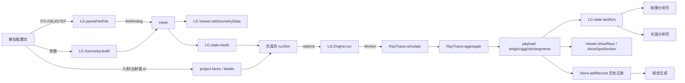

# 01 · 整体架构

## 1. 设计定位

这是一个**零依赖注入、零构建**的静态单页应用。所有代码通过传统 `<script>` 顺序加载，模块之间以全局命名空间 `window.LG` 约定通信。这一选择带来的关键约束：

- **加载顺序即依赖顺序**：`i18n → store → router → geometry → viewer → charts → raytracer → modules → options → app`（见 [index.html](file:///workspace/导光柱光迹模拟工具-20261013/index.html#L37-L51)）。
- **模块只能延迟取用彼此**：例如 `simulate.js` 在运行时才读取 `LG.Modules.spot`，不能在 IIFE 顶层解构，否则会因加载顺序未定义。
- **无 tree-shaking / 无压缩步骤**，`?v=N` 查询参数仅用于破除浏览器缓存。

## 2. 分层视图

```
┌──────────────────────────────────────────────────────────────┐
│ 表现层  index.html + css/style.css                            │
│   顶栏导航 / 语言切换 / #view 容器 / 状态栏 / 模态框            │
└───────────────────────────┬──────────────────────────────────┘
                            │ hash 路由
┌───────────────────────────▼──────────────────────────────────┐
│ 应用外壳层                                                    │
│   app.js       启动、LG.state、LG.Engine(Worker)、文件导入      │
│   router.js    路由注册/渲染/清理                              │
│   i18n.js      双语字典、data-i18n 扫描                        │
│   options.js   界面偏好（卡片显隐、参数提示）                   │
└───────────────────────────┬──────────────────────────────────┘
                            │ render(el) → cleanup
┌───────────────────────────▼──────────────────────────────────┐
│ 业务页面模块层  js/modules/*                                   │
│   home  model  simulate  analysis  spot  report               │
└───────┬───────────────┬──────────────────┬───────────────────┘
        │               │                  │
┌───────▼──────┐ ┌──────▼───────┐ ┌────────▼──────────────────┐
│ 领域服务      │ │ 视图能力      │ │ 计算引擎                   │
│ store.js     │ │ viewer.js    │ │ engine/raytracer.js       │
│ geometry.js  │ │ charts.js    │ │ engine/raytracer.worker.js│
└──────────────┘ └──────────────┘ └───────────────────────────┘
        │                                     │
┌───────▼─────────────────────────────────────▼────────────────┐
│ 浏览器平台：localStorage、Canvas 2D、WebGL、Web Worker、Blob   │
└──────────────────────────────────────────────────────────────┘
```

### 2.1 各层职责边界

| 层 | 文件 | 可以做什么 | 不应做什么 |
| --- | --- | --- | --- |
| 外壳 | `app.js`、`router.js` | 全局状态、路由、Worker 生命周期、文件解析 | 不直接构建页面 DOM |
| 页面 | `js/modules/*` | 生成页面 HTML、绑定事件、调用领域服务 | 不直接实现物理算法 |
| 领域 | `store.js`、`geometry.js` | 数据持久化、网格生成 | 不触碰 DOM（`store` 仅导出 JSON 时用 Blob） |
| 视图 | `viewer.js`、`charts.js` | 3D 场景与图表绘制 | 不读取业务配置（由页面传入数据） |
| 计算 | `engine/*` | 纯数学/物理计算 | **完全不依赖 THREE 与 DOM**，可在 Worker 中运行 |

## 3. 启动时序

`app.js` 的 `boot()` 是唯一入口（[app.js#L439-L471](file:///workspace/导光柱光迹模拟工具-20261013/js/app.js#L439-L471)）：

```
DOMContentLoaded
  │
  ├─ LG.Store.ensureProject()
  │     ├─ load()：读 localStorage
  │     ├─ 执行 4 个幂等迁移（材料吸收、阿贝数/光谱、工程配置、LED 默认开启）
  │     └─ 无项目则 create()，返回 active 项目
  │
  ├─ LG.state.project = project
  ├─ 遍历项目，restoreMeshFromProject() → 恢复 geometry._mesh 到 state.meshCache
  ├─ LG.Viewer.onFilesDrop(handleFileDrop)   // 注册拖放导入回调（此时 3D 尚未初始化）
  ├─ 绑定语言切换按钮 → LG.I18N.setLang()
  ├─ LG.I18N.applyI18n(document)             // 翻译静态 DOM
  │
  ├─ Router.register：home / model / simulate / analysis / spot / report
  └─ Router.init() → navigate() → 渲染当前 hash（默认 'model'）
```

> 注意：`boot()` **不会主动 mount 3D 视图**。`LG.Viewer.mount(slot)` 由具体页面在 `render()` 中调用；`unmount()` 在路由 cleanup 中调用。因此刷新到任意页面都能正确重建。

## 4. 路由与页面生命周期

`router.js` 的约定（[router.js#L10-L39](file:///workspace/导光柱光迹模拟工具-20261013/js/router.js#L10-L39)）：

- 路由名来自 `location.hash`，如 `#/simulate`；缺省/未知回退 `model`。
- `LG.Router.register(name, mod)`，`mod.render(viewEl)` **必须返回可选的 cleanup 函数**。
- 每次导航：先调用上一个页面的 `cleanup()` → 清空 `#view` → 更新导航高亮 → 渲染新页面。
- 语言切换会触发 `lg:lang` 事件 → `LG.Router.rerender()`：先 cleanup 再重渲染，保持 hash 不变。

页面 cleanup 的典型内容：停止动画、解绑 `resize`、`LG.Viewer.unmount()`、清空拾取回调、取消定时器。

## 5. 全局状态

`LG.state`（[app.js#L9-L16](file:///workspace/导光柱光迹模拟工具-20261013/js/app.js#L9-L16)）：

| 字段 | 类型 | 含义 |
| --- | --- | --- |
| `project` | Object | 当前激活项目（`LG.Store.active()` 的引用） |
| `mesh` | `{positions, indices, faceCount, name, isParametric}` | 当前送入引擎与视图的网格（mm） |
| `meshCache` | `{ [projectId]: {positions, indices, name} }` | 导入网格的会话内缓存；切换盘位不丢，刷新后由 `geometry._mesh` 兜底 |
| `lastRun` | Object | 最近一次仿真 payload（含 `agg`、`ledger`、`hits`、`segments`、`params`、`tolerance`） |

> `lastRun` 是跨页面的**唯一仿真数据源**：分析页、光斑页、3D 光斑截面、报告截图都复用它，避免二次仿真造成随机采样偏差。

## 6. 核心数据流

### 6.1 建模 → 仿真 → 分析



### 6.2 一次仿真的参数装配（simulate.js）

`runSim()` 的关键取舍：

| 选项 | 快速预览 `quick` | 精确评估 `precise` |
| --- | --- | --- |
| 光线数 | `min(1600, source.numRays)` | `source.numRays` |
| 最大反弹 | `min(source.maxBounces, 40)` | `source.maxBounces` |
| 热图网格 | 32 | 64 |
| 3D 轨迹采集 | `min(500, rays)` | 800 |
| 公差扫参 | 用户勾选时执行 | 同左 |

`returnSpot: true` 恒为真：出射命中点一次性回传，供 3D 截面与光斑页共用。

### 6.3 能量账本（ledger）

每条光线在追踪过程中累计：

- `output`：从出射面折射离开的能量；
- `side`：从侧面折射漏出的能量；
- `absorbed`：介质吸收（Beer-Lambert / 体散射路径吸收）；
- `residual`：达到反弹上限或数值泄漏的剩余能量。

四者之和用于计算进光利用率 `util = output / (output + side + absorbed + residual)`，是工程结论「亮度」指标的基础。

## 7. 模块依赖矩阵

`→` 表示运行时调用（含延迟取用），`←` 表示被调用。

| 模块 | 依赖 |
| --- | --- |
| `home.js` | `Store`、`Viewer`（离屏 Three 预览）、`Geometry`、`Options` |
| `model.js` | `Store`、`Viewer`、`Geometry`、`Engine.refreshLEDPose`、`app.parsePartFile` |
| `simulate.js` | `Store`、`Engine`、`Viewer`、`Modules.spot.projectLastRun`（3D 出射光斑截面） |
| `analysis.js` | `Store`、`Charts`、`Modules.spot.buildView`、`Modules.analysis.buildConclusion`（报告复用） |
| `spot.js` | `state.lastRun`、`Charts`、Analyzer（本文件纯函数） |
| `report.js` | `Store`、`Modules.spot.capture`、`Modules.analysis.buildConclusion / engStats` |
| `viewer.js` | THREE、`RayTracer.expandAuto`、`Viewer` 自身导出 |
| `charts.js` | 仅 Canvas 2D |
| `engine/raytracer.js` | 无外部依赖（纯 JS） |

**循环依赖风险点**：`simulate → spot`、`report → analysis/spot`。由于都是运行时调用且页面模块均已加载，实际不会死锁；新增模块时应遵守「顶层只引用常量/构造器，跨模块调用放在事件或 render 内部」。

## 8. 错误处理与降级策略

| 场景 | 策略 | 位置 |
| --- | --- | --- |
| Worker 创建失败 | 永久标记 `workerBroken`，`runOnMainThread` | `app.js` |
| Worker 12s 无消息 | 看门狗终止 Worker，永久降级主线程 | `LG.Engine.run` |
| Worker 返回 `error` | Promise reject，页面显示 `status` | `worker.onmessage` |
| 路由渲染抛异常 | 捕获后渲染错误卡片，不影响外壳 | `router.js` |
| localStorage 超限 | `try/catch` 静默失败并 `console.error` | `store.js` |
| 大网格持久化 | 估算 JSON 体积 > 256KB 则不写 `geometry._mesh`，只留内存 | `app.js` |
| STEP 解析器 CDN 失败 | 回调错误，提示重新导入 | `parseSTEP` |
| 3D 未初始化时调用 | `isReady()` 守卫 | 各模块 |

## 9. 性能设计要点

1. **Worker 隔离**：光线追踪是纯计算，放 Worker 避免阻塞 UI；传输使用结构化克隆（`Float32Array`）。
2. **轨迹配额**：统计始终基于全部光线，但只抽 `visRays` 条采集 `segments`，且**等间隔抽取**，保证可视化覆盖整个入射面。
3. **均匀网格加速**：`_buildGrid()` 将三角面装入 3D 均匀网格，射线只与邻近单元求交。
4. **两级网格分离**（光斑页）：指标计算固定 64×64，显示渲染 256×256，避免分辨率影响指标。
5. **快速/精确双模式**：快速模式限制光线与反弹，交互调参时自动重跑（700ms debounce）。
